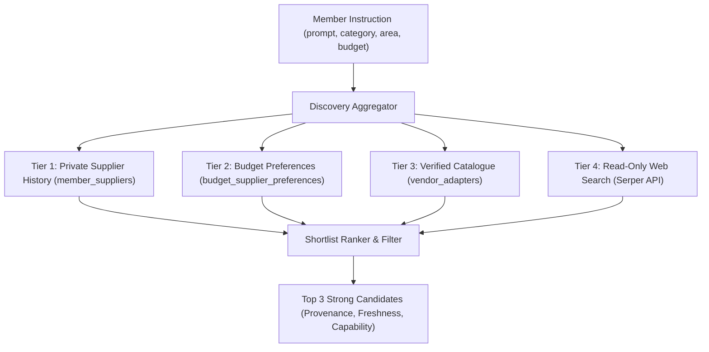

# M2: Discover, Quote, and Review Plan — Implementation & Acceptance Specification

Status: **GREEN-LIT (Chief Engineer Pass 3 Sign-Off · M2 Fixture & PostgreSQL Acceptance Verified · External Execution Disabled)**
Date: **2 November 2026**  
Scope: Milestone M2 (`AC-04`, `AC-05`, `AC-06`, `AC-11`, `FR-01`, `FR-02`, `FR-03`, `FR-04`, `FR-07`, `FR-11`, `FR-13`, `FR-17`, `FR-20`)  
Authority: [Implementation Plan](A-P-P-A-I-agent-product-implementation-plan.md) (Milestone M2, Priority Correction), [PRD](A-P-P-A-I-agent-product-requirements-document.md) (§ 3, § 4), [Technical Requirements](A-P-P-A-I-agent-technical-requirements-document.md) (§ 2, § 3), [Schema](A-P-P-A-I-agent-schema.md) (§ 2, § 3), [Acceptance Matrix](DEVELOPMENT-ACCEPTANCE.md) (`AC-04`, `AC-05`, `AC-06`, `AC-11`), [Supplier Discovery Design](MEMBER-PROMPT-AND-SUPPLIER-DISCOVERY-DESIGN.md).

---

## 1. Problem Statement & Context

Milestones **M0** (capability gates, role taxonomy, PayPal sandbox contract, and connection lifecycle) and **M1** (React 19 + Vite web application, 101-point acceptance matrix, PostgreSQL schedule and timezone matrix, private supplier CRUD, and fulfillment tracking) are complete and committed.

However, external execution remains disabled (`EXECUTION_ENABLED=false`). In M1, supplier quotes were synthetic fixtures created directly by the worker simulation (`local-fixture:synthetic-quote`), and discovery was a raw Serper search probe returning unverified web links.

To reach safe purchasing in M3, the application must first implement **Milestone M2: Discover, quote and review without financial execution**. M2 must solve four concrete architectural gaps:

1. **Gap 1: Multi-Tiered Ranked Supplier Discovery (`FR-01`, `FR-20`, `AC-05`, `AC-19`)**
   - Web search snippets or arbitrary URLs cannot be treated as qualified suppliers.
   - The system must prioritize candidates in strict order:
     - **Tier 1**: Member's private historical suppliers (`member_suppliers`).
     - **Tier 2**: Budget-level preferred suppliers (`budget_supplier_preferences`).
     - **Tier 3**: Category- and area-aware verified catalogue suppliers (`vendor_adapters`).
     - **Tier 4**: Read-only configured web search (`Serper`) with source provenance.
   - Shortlist is capped at **at most 3 strong candidates** with explicit freshness and evidence.
   - Privacy invariant: Member supplier history and purchase records remain strictly private and owner-isolated in PostgreSQL; no cross-member sharing or public directory.

2. **Gap 2: Authoritative Quotes & Exact Minor-Unit Arithmetic (`FR-03`, `FR-11`, `AC-05`)**
   - Search snippets, scraped text, or conversational estimates are strictly prohibited from authorizing checkout or becoming executable orders.
   - An executable quote must be an immutable `vendor_quotes` record with:
     - Exact minor-unit arithmetic: `subtotal_minor + tax_minor + shipping_minor + fees_minor - discount_minor === total_minor`.
     - Strict currency alignment with instruction and budget currency.
     - Deterministic cryptographic content hash (`quote_hash = SHA-256(...)`).
     - Explicit expiration timestamp (`expires_at`).
   - If arithmetic fails to reconcile or currency mismatches, the quote is rejected immediately (`UNRECONCILED_QUOTE_ARITHMETIC`, `CURRENCY_MISMATCH`).

3. **Gap 3: Typed Category Validation Contracts (`FR-01`, `FR-02`, `FR-11`, `AC-04`)**
   - The system must validate domain criteria according to category:
     - **`PRODUCT`**: item variant, positive integer quantity, delivery address/window, return policy, seller reputation.
     - **`BILL`**: payee label, account identifier, invoice/meter number, billing cycle, authoritative unpaid status.
     - **`ACCOMMODATION`**: destination, valid check-in/check-out dates, guest/room count, room rate, cancellation policy.
   - Incorrect, ambiguous, or incomplete candidates must never become executable quotes. Watches without a match must continue waiting until expiry without inventing candidates.

4. **Gap 4: One-Time Authenticated Approvals & Stale-Consent Invalidation (`FR-04`, `FR-07`, `FR-17`, `AC-06`, `AC-11`)**
   - `REVIEW_REQUIRED` instructions emit a durable inbox notification and wait for explicit member action.
   - Approving or rejecting an offer is a one-time, versioned transaction in PostgreSQL (`approvals`).
   - Opening an inbox notification, approval modal, or deep link is **strictly read-only**; navigation never dispatches payment or changes approval state (`AC-11`, `AC-21`).
   - Any material change (price increase, seller change, date modification, instruction schedule amendment, or agreement version bump) strictly invalidates previous consent (`INVALIDATED` / `EXPIRED`).
   - `NOTIFY_ONLY` instructions observe and notify only; they never create approvals or operations (`AC-06`).
   - `PRE_APPROVED` operations execute only when all exact constraints, budget limits, and soft thresholds pass.

---

## 2. Solution Architecture & Technical Contracts

### 2.1 Discovery & Ranking Pipeline (`GET /api/v1/discovery/candidates`)



- **Candidate Interface (`CandidateSupplier`)**:
  ```ts
  export interface CandidateSupplier {
    id: string;
    name: string;
    tier: 'PRIVATE_HISTORY' | 'BUDGET_PREFERRED' | 'CATALOGUE' | 'WEB_RESEARCH';
    category: 'PRODUCT' | 'BILL' | 'ACCOMMODATION';
    serviceArea?: string;
    sourceUrl?: string;
    verifiedPaypalSupport: boolean;
    freshnessTimestamp: string;
    confidenceScore: number;
    notes?: string;
  }
  ```

### 2.2 Authoritative Quote Engine (`packages/domain/src/quotes.ts`)

- **Quote Content Hash Formula**:
  $$\text{quote\_hash} = \text{SHA-256}\left(\text{canonicalJSON}\left(\{ \text{sourceQuoteKey}, \text{subtotal}, \text{tax}, \text{shipping}, \text{fees}, \text{discount}, \text{total}, \text{currency}, \text{payee}, \text{terms} \}\right)\right)$$
- **Reconciliation Invariant**:
  $$\text{total\_minor} = \text{subtotal\_minor} + \text{tax\_minor} + \text{shipping\_minor} + \text{fees\_minor} - \text{discount\_minor}$$
- **Quote Lifecycle**:
  `ACTIVE` $\rightarrow$ `EXPIRED` (when $\text{now}() > \text{expires\_at}$) or `INVALIDATED` (on material scope change).

### 2.3 Category Validation Contracts (`packages/domain/src/categories.ts`)

| Category | Required Fields | Invariants Enforced |
| :--- | :--- | :--- |
| **`PRODUCT`** | `variant`, `quantity`, `deliveryWindow`, `returnPolicy` | `quantity >= 1`, delivery date within validity window, return policy defined. |
| **`BILL`** | `payeeName`, `accountRef`, `invoiceRef`, `billingCycle`, `unpaidStatus` | `unpaidStatus === 'UNPAID'`, bill cycle valid format (`YYYY-MM`), account number non-secret. |
| **`ACCOMMODATION`** | `destination`, `checkIn`, `checkOut`, `guests`, `rooms`, `rateType`, `cancellationTerms` | `checkOut > checkIn`, `guests >= 1`, `rooms >= 1`, non-empty destination, valid ISO dates. |

### 2.4 Approval Decision Engine (`POST /api/v1/approvals/:id/decide`)

- Atomic state transition in PostgreSQL:
  ```sql
  UPDATE approvals
  SET status = $3, decided_at = now(), decided_by_subject = $4, version = version + 1
  WHERE id = $1 AND owner_id = $2 AND status = 'PENDING' AND expires_at > now()
  RETURNING id, operation_id, quote_id, status, version;
  ```
- If instruction permission version has bumped, approval decision is rejected with `409 STALE_AGREEMENT_VERSION`.
- Opening an approval URL (`GET /api/v1/approvals/:id`) returns read-only quote details without modifying database state.

---

## 3. Step-by-Step Implementation Plan

### Step 1: Typed Category Validation Contracts (`packages/domain/src/categories.ts`)
1. Create `packages/domain/src/categories.ts` implementing:
   - `validateProductCriteria(details: unknown): CategoryValidationResult<ProductDetails>`
   - `validateBillCriteria(details: unknown): CategoryValidationResult<BillDetails>`
   - `validateAccommodationCriteria(details: unknown): CategoryValidationResult<AccommodationDetails>`
2. Create `packages/domain/test/categories.test.ts` testing:
   - Rejection of invalid quantities, past delivery dates, ambiguous variant descriptors.
   - Rejection of already-paid bills or missing invoice identities.
   - Rejection of checkout before checkin, 0 guests, or missing cancellation terms.
   - Verification that watch instructions continue waiting to expiry when criteria do not match (`AC-04`).

### Step 2: Authoritative Quote Engine (`packages/domain/src/quotes.ts`)
1. Create `packages/domain/src/quotes.ts` implementing:
   - Exact minor-unit arithmetic validator (`reconcileQuoteTotals`).
   - Cryptographic `computeQuoteHash(quote: CanonicalQuoteInput): string`.
   - Currency match verification against budget and instruction limits.
2. In `packages/domain/test/quotes.test.ts`, verify:
   - Quote arithmetic mismatch fails closed (`UNRECONCILED_QUOTE_ARITHMETIC`).
   - Currency mismatch fails closed (`CURRENCY_MISMATCH`).
   - Hash changes if any minor unit or terms change.

### Step 3: Discovery & Ranked Shortlist API (`apps/api/src/server.ts`)
1. Implement `GET /api/v1/discovery/candidates`:
   - Accept query parameters: `instructionId`, `category`, `area`, `query`.
   - Query `member_suppliers` for matching categories/serviceAreas (Tier 1).
   - Query `budget_supplier_preferences` for preferred rankings (Tier 2).
   - Query `vendor_adapters` with capability categories (Tier 3).
   - If enabled and query provided, query `Serper` search API (Tier 4).
   - Merge, score, rank, and return at most 3 `candidates` with provenance metadata.
2. Ensure strict owner isolation: `owner_id = member.id` enforced on all queries.

### Step 4: Authoritative Quote Persistence & One-Time Approvals (`apps/api/src/server.ts`)
1. Implement `POST /api/v1/instructions/:id/quotes`:
   - Validates category details, calculates exact totals, verifies budget headroom, computes `quote_hash`, and persists to `vendor_quotes`.
   - Creates a bound `purchase_operations` row in state `REVIEW_REQUIRED`.
   - Inserts a `PENDING` row in `approvals` with `expires_at = now() + interval '24 hours'`.
   - Emits a durable `notifications` record with `type = 'FIXTURE_REVIEW_REQUESTED'`.
2. Implement `GET /api/v1/approvals/:id`:
   - Strictly read-only; returns quote breakdown, shipping, taxes, cancellation terms, and approval status.
3. Implement `POST /api/v1/approvals/:id/decide`:
   - Accepts `{ decision: 'APPROVE' | 'REJECT', rejectReason?: string }`.
   - Enforces optimistic concurrency (`If-Match: "${version}"`).
   - Transitions approval to `APPROVED` or `REJECTED`.
   - If `REJECTED`, marks operation `CANCELLED` and logs audit event.
   - If instruction agreement version has changed, blocks with `409 STALE_AGREEMENT_VERSION`.

### Step 5: Worker Watch Evaluation & Quote Expiry Sweeper (`apps/worker/src/worker.ts`)
1. In `apps/worker/src/worker.ts`:
   - In `processObservation`: validate candidate category details against instruction criteria; if criteria match, generate quote; if no match, log observation and leave instruction `ACTIVE` until `valid_until` (`AC-04`).
   - Add background sweeper `expireStaleQuotes()`:
     - Mark `approvals` as `EXPIRED` where `expires_at <= now() AND status = 'PENDING'`.
     - Mark `vendor_quotes` as `EXPIRED` where `expires_at <= now() AND status = 'ACTIVE'`.
     - Notify member that quote expired.

### Step 6: Frontend Integration (`src/`)
1. In `src/store/domainCore.ts`:
   - Add `candidates: CandidateSupplier[]` to state.
   - Ensure `validateOfferEligibility` strictly verifies quote arithmetic and `quote_hash`.
2. In `src/components/screens/OfferReviewModal.tsx`:
   - Display full minor-unit breakdown: Subtotal, Shipping, Tax, Fees, Discounts, Total.
   - Display explicit cancellation terms, return policy, and quote expiration countdown.
   - Ensure modal open is pure presentation; only explicit "Approve" button triggers decision API.
3. In `src/components/screens/ConversationScreen.tsx`:
   - Display ranked discovery candidates (up to 3) in chat stream with source badges.

### Step 7: Acceptance Integration Test Suite (`scripts/test-m2-discovery-quote-workflow.mjs`)
1. Create `scripts/test-m2-discovery-quote-workflow.mjs` verifying:
   - Category validation: Product variant/qty, Bill invoice/cycle/unpaid, Accommodation checkin/checkout/rates (`AC-04`).
   - Authoritative quote exact arithmetic, hash binding, and rejection of scraped/unreconciled totals (`AC-05`).
   - Review-required approval flow: read-only deep link, one-time decision, and invalidation on amendment (`AC-06`, `AC-11`).
   - Ranked discovery: Tier 1/2/3/4 ordering and private history isolation.
   - Quote expiration: Sweeper marks stale quotes `EXPIRED`.
2. Register `"test:m2": "npm run build:api && npm run build:worker && node --env-file-if-exists=.env scripts/test-m2-discovery-quote-workflow.mjs"` in `package.json`.

---

## 4. Chief Engineer Review — Pass 2 Audit & Remediation Specification for Dev

**Review Date**: 2 November 2026
**Review Verdict**: **PARTIAL PASS (Slice 1 Verified · 5 Remediation Items Required Before M2 Green-Light)**

### 4.1 What Passed in Slice 1
- **Domain Category & Quote Primitives (`packages/domain/src/index.ts`, `8/8` pass in `npm run test:domain`)**:
  - `validateProductCriteria`, `validateBillCriteria`, and `validateAccommodationCriteria` enforce category constraints and reject already-paid bills and invalid stay date ranges.
  - `reconcileQuoteTotals` and `computeQuoteHash` enforce exact minor-unit arithmetic (`UNRECONCILED_QUOTE_ARITHMETIC`), currency match (`CURRENCY_MISMATCH`), and canonical SHA-256 hashing.
- **Quote Lifecycle Schema & Worker Expiry Sweeper (`014_quote_lifecycle.sql`, `015_quote_lifecycle_cleanup.sql`, `expireStaleApprovals`)**:
  - `vendor_quote_lifecycle` tracks `ACTIVE`, `EXPIRED`, and `INVALIDATED` states without mutating immutable `vendor_quotes` rows.
  - Instruction amendments (`POST /api/v1/instructions/:id/confirm-agreement` and `PATCH /api/v1/instructions/:id/configuration`) invalidate active `vendor_quote_lifecycle` rows and pending `approvals`.
- **Read-Only Approval Inspection (`GET /api/v1/approvals/:id`)**:
  - Returns `readOnly: true` without mutating `PENDING` state and blocks stale agreement versions with `409 STALE_AGREEMENT_VERSION`.

---

### 4.2 Five Remaining Blockers Dev Must Implement to Green-Light M2

#### Item M2-R1: Fix Duplicate Supplier Bug in Ranked Discovery (`apps/api/src/server.ts`)
- **Problem**: In `GET /api/v1/discovery/candidates` (`apps/api/src/server.ts` lines 1253–1275), `privateCandidates` and `preferredCandidates` both query `member_suppliers` and are concatenated without deduplicating by supplier `id`. When a member's private supplier is also ranked in `budget_supplier_preferences`, the same supplier appears twice in the top-3 `ranked` list.
- **Required Fix**:
  1. Deduplicate candidates by supplier `id` before slicing to `.slice(0, 3)`.
  2. When a private supplier is also present in `preferredCandidates` for the active budget, order `BUDGET_PREFERRED` (or merged `PRIVATE_HISTORY` + `BUDGET_PREFERRED` with `preferenceRank`) first so each unique supplier occupies at most 1 slot in the top-3 shortlist.

#### Item M2-R2: Wire Domain Category & Quote Validators into API Quote Creation (`apps/api/src/server.ts`)
- **Problem**: `validateProductCriteria`, `validateBillCriteria`, `validateAccommodationCriteria`, `reconcileQuoteTotals`, and `computeQuoteHash` exist in `packages/domain/src/index.ts`, but neither `apps/api/src/server.ts` nor `apps/worker/src/worker.ts` imports or calls them. Furthermore, `POST /api/v1/instructions/:id/quotes` (Step 4) is not yet implemented.
- **Required Fix**:
  1. Import `validateProductCriteria`, `validateBillCriteria`, `validateAccommodationCriteria`, `reconcileQuoteTotals`, and `computeQuoteHash` into `apps/api/src/server.ts` (and `apps/worker/src/worker.ts`).
  2. Implement `POST /api/v1/instructions/:id/quotes` (owner-scoped, idempotent via `Idempotency-Key`):
     - Reject non-authoritative discovery inputs where `evidenceType` is `'SEARCH_SNIPPET'`, `'ESTIMATE'`, `'ADVERTISED_OFFER'`, or `'STALE_STOCK'` with `422 NON_AUTHORITATIVE_DISCOVERY_EVIDENCE` (`AC-05`).
     - Validate category-specific `typedDetails` against the instruction's category (`validateProductCriteria`, `validateBillCriteria`, or `validateAccommodationCriteria`) and verify constraint compatibility against `instruction.structured_constraints.categoryDetails` (e.g., destination, checkIn/checkOut, guests/rooms, unpaidStatus, variant/quantity). Reject mismatches with `422 CATEGORY_CRITERIA_MISMATCH` (`AC-04`).
     - Validate exact minor-unit arithmetic (`subtotalMinor + taxMinor + shippingMinor + feesMinor - discountMinor === totalMinor`) and currency match via `reconcileQuoteTotals`. Reject mismatches with `422 UNRECONCILED_QUOTE_ARITHMETIC` or `422 CURRENCY_MISMATCH` (`AC-05`).
     - Enforce price ceiling: if `BigInt(totalMinor) > BigInt(instruction.max_total_minor)`, reject with `422 QUOTE_EXCEEDS_MAX_TOTAL`.
     - Compute deterministic `content_hash = computeQuoteHash(...)`, persist to `vendor_quotes`, create/update the bound `purchase_operations` row (`FIXTURE_AWAITING_REVIEW` when `REVIEW_REQUIRED` or when `PRE_APPROVED` exceeds `softReviewThresholdMinor`; `FIXTURE_COMPLETED` when `PRE_APPROVED` within threshold; `FIXTURE_QUOTED` when `NOTIFY_ONLY`), and emit the corresponding `approvals` and `notifications` rows.

#### Item M2-R3: Worker Watch Criteria Evaluation, No-Match Continuation & Soft Review Threshold (`apps/worker/src/worker.ts`)
- **Problem**:
  - `processObservation` (`apps/worker/src/worker.ts` lines 523–552) currently blocks any watch whose mode is not `NOTIFY_ONLY` (`WATCH_PERMISSION_UNSUPPORTED`) and unconditionally writes a synthetic match on the first run instead of evaluating candidate criteria and continuing to wait until `valid_until` when no candidate matches (`AC-04`, `AC-06`).
  - `processOccurrence` (`apps/worker/src/worker.ts` lines 416–435) does not check `softReviewThresholdMinor` on `PRE_APPROVED` instructions (`AC-06`).
- **Required Fix**:
  1. In `apps/api/src/server.ts` (`/readiness` and `/activate-fixture`) and `apps/worker/src/worker.ts` (`processObservation`):
     - Allow `WATCH` instructions with `mode IN ('NOTIFY_ONLY', 'REVIEW_REQUIRED', 'PRE_APPROVED')` and `watchConfig.frequency IN ('ONCE', 'INTERVAL')`.
  2. In `processObservation`:
     - Inspect candidate offer payload (if provided in `job.payload.candidateOffer` or `instruction.structured_constraints.watchCandidate`).
     - If a candidate is marked no-match or fails category criteria validation (`validateProductCriteria` / `validateBillCriteria` / `validateAccommodationCriteria`) or exceeds `max_total_minor`:
       - Do **not** create a `vendor_quotes` or `approvals` row.
       - Record an audit/observation trace (`WATCH_NO_MATCH_CONTINUING`).
       - If `now() < instruction.validUntil`, advance `procurement_instructions.next_run_at` to the next poll interval (e.g., `LEAST(instruction.valid_until, now() + interval '1 hour')`) and keep `instruction.state = 'ACTIVE'` (`AC-04`). If `now() >= instruction.validUntil`, transition instruction to `EXPIRED`.
     - If the candidate matches all category criteria and `totalMinor <= max_total_minor`:
       - Deduplicate via `offer_observations (instruction_id, source_offer_key, material_fingerprint)`.
       - If `mode === 'NOTIFY_ONLY'`, record the observation and `FIXTURE_OBSERVATION` notification without creating an approval or purchase operation (`AC-06`).
       - If `mode === 'REVIEW_REQUIRED'` (e.g., Arusha stay watch match), create the `purchase_operations` (`FIXTURE_AWAITING_REVIEW`), immutable `vendor_quotes`, `PENDING` `approvals` row, and `FIXTURE_REVIEW_REQUESTED` notification (`AC-06`).
  3. In `processOccurrence` (and quote evaluation):
     - Check `softReviewThresholdMinor` in `instruction.structured_constraints` (or `categoryDetails`). When `instruction.mode === 'PRE_APPROVED'` and `BigInt(totalMinor) > BigInt(softReviewThresholdMinor)` (while `<= BigInt(instruction.max_total_minor)`), route the operation to `FIXTURE_AWAITING_REVIEW` and create a `PENDING` `approvals` row instead of auto-completing (`AC-06`).

#### Item M2-R4: Enforce `vendor_quote_lifecycle` & Quote Expiry in Approval Routes (`apps/api/src/server.ts`)
- **Problem**: `GET /api/v1/approvals/:id` and `POST /api/v1/approvals/:id/fixture-decision` (`apps/api/src/server.ts` lines 2008–2095) do not check `vendor_quote_lifecycle.state` or `q.expires_at > now()`.
- **Required Fix**:
  1. Left-join `vendor_quote_lifecycle l ON l.owner_id = q.owner_id AND l.quote_id = q.id` in both `GET /api/v1/approvals/:id` and `POST /api/v1/approvals/:id/fixture-decision`.
  2. In `POST /api/v1/approvals/:id/fixture-decision` (and `POST /api/v1/approvals/:id/decide` alias if exposed):
     - If `l.state === 'INVALIDATED'` or `Number(approval.permissionVersion) !== Number(approval.currentPermissionVersion)`, return `409 STALE_AGREEMENT_VERSION` (or `409 QUOTE_INVALIDATED`).
     - If `l.state === 'EXPIRED'` or `new Date(approval.quoteExpiresAt) <= new Date()` or `approval.approvalStatus !== 'PENDING'` or `new Date(approval.expiresAt) <= new Date()`, return `410 APPROVAL_EXPIRED_OR_DECIDED`.
  3. Expose `POST /api/v1/approvals/:id/decide` as an alias/canonical route alongside `POST /api/v1/approvals/:id/fixture-decision` so both the M1 fixture test and M2 acceptance suite work seamlessly.

#### Item M2-R5: Create Dedicated PostgreSQL M2 Acceptance Suite (`scripts/test-m2-discovery-quote-workflow.mjs`)
- **Problem**: `package.json` currently aliases `"test:m2"` to `"npm run test:domain && npm run test:m1:workflow"`. There is no dedicated M2 PostgreSQL verification script testing `AC-04`, `AC-05`, `AC-06`, and `AC-11`.
- **Required Fix**:
  1. Create `scripts/test-m2-discovery-quote-workflow.mjs` and wire `"test:m2": "npm run test:domain && npm run build:api && npm run build:worker && node --env-file-if-exists=.env scripts/test-m2-discovery-quote-workflow.mjs"` in `package.json`.
  2. The script must verify against PostgreSQL:
     - **Discovery & Deduplication (`AC-05`, `FR-01`)**: Tiered ranking returns at most 3 unique candidates (`BUDGET_PREFERRED` / `PRIVATE_HISTORY` / `CATALOGUE`), does not duplicate a supplier that is both in `member_suppliers` and `budget_supplier_preferences`, and enforces strict cross-member isolation.
     - **Category Criteria Validation & Rejection (`AC-04`)**:
       - `PRODUCT`: rejects quantity `0` or missing variant/returnPolicy.
       - `BILL`: rejects `unpaidStatus: 'PAID'` or malformed billing cycle.
       - `ACCOMMODATION`: rejects `checkOut <= checkIn`, `0` guests/rooms, or missing cancellation terms.
     - **No-Match Watch Continuation (`AC-04`)**: A watch instruction that evaluates a non-matching candidate records no quote/approval, remains `ACTIVE`, and advances `next_run_at` to continue waiting until `valid_until`.
     - **Authoritative Quote Arithmetic, Hash & Snippet Rejection (`AC-05`)**:
       - Rejects `SEARCH_SNIPPET` / `ESTIMATE` evidence from creating an executable quote (`422 NON_AUTHORITATIVE_DISCOVERY_EVIDENCE`).
       - Rejects unreconciled minor-unit arithmetic (`subtotal + tax + shipping + fees - discount !== total`) with `422 UNRECONCILED_QUOTE_ARITHMETIC` and currency mismatch with `422 CURRENCY_MISMATCH`.
       - Persists a valid authoritative quote with exact SHA-256 `content_hash` and `vendor_quote_lifecycle` state `ACTIVE`.
     - **Arusha Stay Watch-to-Review & Soft Threshold (`AC-06`)**:
       - Matching `REVIEW_REQUIRED` Arusha accommodation watch creates 1 `FIXTURE_AWAITING_REVIEW` operation, 1 immutable quote, 1 `PENDING` approval, and 1 durable notification.
       - `PRE_APPROVED` quote above `softReviewThresholdMinor` (but `<= max_total_minor`) routes to `FIXTURE_AWAITING_REVIEW` instead of auto-completing.
       - `NOTIFY_ONLY` never creates an approval or executes a purchase.
     - **One-Time Approvals, Read-Only Deep Link, Expiry Sweeper & Amendment Invalidation (`AC-11`)**:
       - `GET /api/v1/approvals/:id` is strictly read-only (`status` remains `PENDING`).
       - Amending instruction configuration/agreement bumps `permission_version`, marks `approvals.status = 'INVALIDATED'` and `vendor_quote_lifecycle.state = 'INVALIDATED'`, and blocks subsequent approval decisions with `409` / `410`.
       - Concurrent approve vs. reject race (`Promise.all`) accepts exactly 1 winner (`200`) and rejects the loser (`410`/`412`).
       - Worker expiry sweeper transitions expired quotes/approvals to `EXPIRED` and emits expiry notifications.

### 4.3 Pass 2 Remediation Status

All five Pass 2 blockers are implemented and covered by the dedicated `npm run test:m2` suite:

- **M2-R1 — Complete**: Discovery deduplicates by supplier ID. A private supplier preferred in the active budget is represented once and promoted with the budget preference rank. The top three limit and cross-member isolation are covered.
- **M2-R2 — Complete for fixture quote intake**: `POST /api/v1/instructions/:id/quotes` is owner-scoped and idempotent. It rejects non-authoritative evidence, invalid category details and instruction mismatches, unreconciled totals, currency mismatches, and totals above the instruction ceiling. Valid quote records use the canonical hash and immutable fixture quote storage; review approvals and notifications are persisted. The route always reports `fixtureOnly: true` and never calls a vendor or payment provider.
- **M2-R3 — Complete for fixture watches**: Fixture watches accept `NOTIFY_ONLY`, `REVIEW_REQUIRED`, and `PRE_APPROVED` with `ONCE` or `INTERVAL` schedules. No-match observations continue until expiry without creating operations, quotes, or approvals. Matching review watches create quote and approval records; notify-only watches do not. Pre-approved totals above the configured soft threshold wait for review.
- **M2-R4 — Complete**: Read and decision routes check quote lifecycle and expiry. `/decide` aliases the existing fixture decision route. Stale agreements return `409`; expired or already-decided approvals return `410`.
- **M2-R5 — Complete**: `test:m2` runs the domain contracts and the PostgreSQL workflow scenarios through `scripts/test-m2-discovery-quote-workflow.mjs`.

**Observed verification, 2 November 2026:** `npm run test:m2` passed 8 domain tests and the PostgreSQL fixture workflow, including supplier deduplication, quote evidence/arithmetic/currency/ceiling checks, approval read-only and concurrent decisions, amendment invalidation, quote expiry sweep, watch matching/no-match continuation, and soft-threshold routing. `test:m0`, `test:ac03`, `test:auth`, and the 101-assertion acceptance matrix also passed. External execution remains disabled. This closes the five listed code blockers; it does not establish provider-sourced authoritative quotes or production checkout capability.

### 4.4 Final Checkpoint Verification Record

**Checkpoint:** Commit `e7e276f` on `main` (`Complete M2 discovery and quote review remediation`); worktree clean after commit.

**Observed locally on 2 November 2026:**

| Command | Result | Evidence boundary |
| :--- | :--- | :--- |
| `npm run test:m2` | Passed: 8 domain tests plus PostgreSQL M1/M2 fixture workflows, including the M2 cases listed in § 4.3. | Local PostgreSQL; fixture-only workflows; no vendor or payment API called. |
| `npm run test:m0` | Passed: `AC-02`, `AC-12`, and `AC-17`; `liveExecutionEnabled: false`. | Local PostgreSQL capability and mandate gates; no live execution. |
| `npm run test:acceptance` | Passed: 101 assertions, 0 failures. | Automated domain/UI lifecycle acceptance suite. |
| `npm run build` | Passed: Vite production build completed. | Local production bundle build. |
| `git diff --check` | Passed before commit. | Whitespace/error check for the committed changes. |

These results verify the committed fixture implementation and local acceptance contracts. They do not establish provider-sourced quote normalization, validated live vendor/category coverage, or production checkout capability.

### 4.5 Chief Engineer Pass 3 Audit & Final Sign-Off

**Review Date**: 2 November 2026  
**Verdict**: **GREEN-LIT (`AC-04`, `AC-05`, `AC-06`, `AC-11` Passed in Domain & PostgreSQL Fixture Mode; External Execution Disabled)**

All 5 Pass 2 remediation items (`M2-R1` through `M2-R5`) were independently audited in code and verified against live local PostgreSQL (`127.0.0.1:5433`):
- **`M2-R1` (`GET /api/v1/discovery/candidates`)**: Verified in `apps/api/src/server.ts` (lines 1300–1319) — `candidateById` Map deduplicates private suppliers that also appear in `budget_supplier_preferences`, promoting budget-preferred private suppliers (`confidenceScore: 0.85`, `tier: 'BUDGET_PREFERRED'`) ahead of unranked private history without duplicating entries in the top-3 shortlist.
- **`M2-R2` (`POST /api/v1/instructions/:id/quotes`)**: Verified in `apps/api/src/server.ts` (lines 2017–2100) — owner-scoped, idempotent route rejects `SEARCH_SNIPPET` / `ESTIMATE` / `ADVERTISED_OFFER` / `STALE_STOCK` (`422 NON_AUTHORITATIVE_DISCOVERY_EVIDENCE`), enforces `validateProductCriteria` / `validateBillCriteria` / `validateAccommodationCriteria` plus instruction constraint matching (`422 CATEGORY_CRITERIA_MISMATCH`), reconciles exact minor-unit components (`422 UNRECONCILED_QUOTE_ARITHMETIC`, `422 CURRENCY_MISMATCH`), enforces `max_total_minor` (`422 QUOTE_EXCEEDS_MAX_TOTAL`), and persists immutable `vendor_quotes` with canonical `computeQuoteHash`.
- **`M2-R3` (`processObservation` & `processOccurrence`)**: Verified in `apps/worker/src/worker.ts` (lines 419–447, 532–647) — supports `WATCH` instructions across `NOTIFY_ONLY`, `REVIEW_REQUIRED`, and `PRE_APPROVED` with `ONCE` or `INTERVAL` polling; non-matching watch observations log `WATCH_NO_MATCH_CONTINUING` and advance `next_run_at` without creating operations/quotes/approvals; matching `REVIEW_REQUIRED` watches (Arusha stay) create 1 `FIXTURE_AWAITING_REVIEW` operation, 1 quote, and 1 `PENDING` approval; `PRE_APPROVED` quotes above `softReviewThresholdMinor` route to `FIXTURE_AWAITING_REVIEW`.
- **`M2-R4` (`GET /api/v1/approvals/:id` & `POST /api/v1/approvals/:id/decide`)**: Verified in `apps/api/src/server.ts` (lines 2137–2270) — joins `vendor_quote_lifecycle`, blocks invalidated quotes or bumped `permission_version` with `409 STALE_AGREEMENT_VERSION`, blocks expired quotes/approvals with `410 APPROVAL_EXPIRED_OR_DECIDED`, and enforces single-winner concurrency under `FOR UPDATE OF a, o`.
- **`M2-R5` (`npm run test:m2`)**: Verified live execution of `npm run test:m2` (`8/8` domain tests + full PostgreSQL M1/M2 workflow), `npm run test:m0`, `npm run test:ac03`, `npm run test:auth`, `npm run test:paypal` (`3/3`), `npm run test:acceptance` (`101/101`), and `npm run build` (`0` errors).

---

## 5. Verification & Exit Checklist

| Checkpoint | Target Contract | Verification Suite / Evidence | Status |
| :--- | :--- | :--- | :--- |
| **AC-04 Pass** | Category constraints strictly validated; incorrect/ambiguous candidates never quote; no-match watches continue | `npm run test:m2` + `npm run test:domain` | **PASSED (Fixture/DB)** |
| **AC-05 Pass** | Exact minor-unit arithmetic; cryptographic quote hash; search snippets alone cannot purchase | `npm run test:m2` + `packages/domain/test/domain.test.js` | **PASSED (Fixture/DB)** |
| **AC-06 Pass** | Review-required match creates pending approval; pre-approved executes only within scope & soft threshold; notify-only never purchases | `npm run test:m2` + `npm run test:acceptance` | **PASSED (Fixture/DB)** |
| **AC-11 Pass** | Material scope change invalidates consent; opening notification/modal is read-only; concurrent race & replay rejected | `npm run test:m2` + `npm run test:acceptance` (Suite C16) | **PASSED (Fixture/DB)** |
| **Private Isolation** | Cross-member discovery or supplier leak strictly returns 404/403; no duplicate supplier in top-3 shortlist | PostgreSQL isolation queries in `test-m2-discovery-quote-workflow.mjs` | **PASSED (DB)** |
| **Full Regression** | Zero regressions across M0, M1, and web build | `npm run test:m0`, `test:ac03`, `test:m1:workflow`, `test:auth`, `npm run build` | **PASSED** |

---

## 6. Mandatory Collaboration Lifecycle Gate

Per [`AGENTS.md`](../AGENTS.md):
> **Mandatory Collaboration Lifecycle**: Always follow **Problem → Solution → Plan → Signed → Implementation**.
> Halt and wait for user sign-off ("signed" / "proceed") before applying modifications.

**Milestone M2 Sign-Off**: **GREEN-LIT** (2 November 2026). Ready to advance to **Milestone M3** planning and review.
