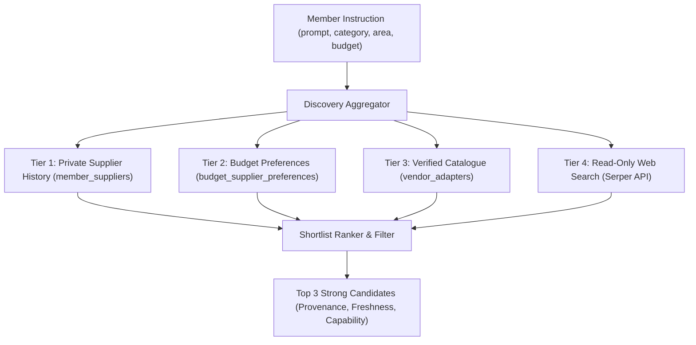

# M2: Discover, Quote, and Review Plan — Implementation & Acceptance Specification

Status: **Implementation in progress · external execution remains disabled**
Date: **2 November 2026**  
Scope: Milestone M2 (`AC-04`, `AC-05`, `AC-06`, `AC-11`, `FR-01`, `FR-02`, `FR-03`, `FR-04`, `FR-07`, `FR-11`, `FR-13`, `FR-17`, `FR-20`)  
Authority: [Implementation Plan](A-P-P-A-I-agent-product-implementation-plan.md) (Milestone M2, Priority Correction), [PRD](A-P-P-A-I-agent-product-requirements-document.md) (§ 3, § 4), [Technical Requirements](A-P-P-A-I-agent-technical-requirements-document.md) (§ 2, § 3), [Schema](A-P-P-A-I-agent-schema.md) (§ 2, § 3), [Acceptance Matrix](DEVELOPMENT-ACCEPTANCE.md) (`AC-04`, `AC-05`, `AC-06`, `AC-11`), [Supplier Discovery Design](MEMBER-PROMPT-AND-SUPPLIER-DISCOVERY-DESIGN.md).

---

## 1. Problem Statement & Context

Milestones **M0** (capability gates, role taxonomy, PayPal sandbox contract, and connection lifecycle) and **M1** (React 19 + Vite web application, 101-point acceptance matrix, PostgreSQL schedule and timezone matrix, private supplier CRUD, and fulfillment tracking) are complete and committed.

However, external execution remains disabled (`EXECUTION_ENABLED=false`). In M1, supplier quotes were synthetic fixtures created directly by the worker simulation (`local-fixture:synthetic-quote`), and discovery was a raw Serper search probe returning unverified web links.

To reach safe purchasing in M3, the application must first implement **Milestone M2: Discover, quote and review without financial execution**. M2 must solve four concrete architectural gaps:

1. **Gap 1: Multi-Tiered Ranked Supplier Discovery (`FR-01`, `FR-20`, `AC-05`, `AC-19`)**
   - Web search snippets or arbitrary URLs cannot be treated as qualified suppliers.
   - The system must prioritize candidates in strict order:
     - **Tier 1**: Member's private historical suppliers (`member_suppliers`).
     - **Tier 2**: Budget-level preferred suppliers (`budget_supplier_preferences`).
     - **Tier 3**: Category- and area-aware verified catalogue suppliers (`vendor_adapters`).
     - **Tier 4**: Read-only configured web search (`Serper`) with source provenance.
   - Shortlist is capped at **at most 3 strong candidates** with explicit freshness and evidence.
   - Privacy invariant: Member supplier history and purchase records remain strictly private and owner-isolated in PostgreSQL; no cross-member sharing or public directory.

2. **Gap 2: Authoritative Quotes & Exact Minor-Unit Arithmetic (`FR-03`, `FR-11`, `AC-05`)**
   - Search snippets, scraped text, or conversational estimates are strictly prohibited from authorizing checkout or becoming executable orders.
   - An executable quote must be an immutable `vendor_quotes` record with:
     - Exact minor-unit arithmetic: `subtotal_minor + tax_minor + shipping_minor + fees_minor - discount_minor === total_minor`.
     - Strict currency alignment with instruction and budget currency.
     - Deterministic cryptographic content hash (`quote_hash = SHA-256(...)`).
     - Explicit expiration timestamp (`expires_at`).
   - If arithmetic fails to reconcile or currency mismatches, the quote is rejected immediately (`UNRECONCILED_QUOTE_ARITHMETIC`, `CURRENCY_MISMATCH`).

3. **Gap 3: Typed Category Validation Contracts (`FR-01`, `FR-02`, `FR-11`, `AC-04`)**
   - The system must validate domain criteria according to category:
     - **`PRODUCT`**: item variant, positive integer quantity, delivery address/window, return policy, seller reputation.
     - **`BILL`**: payee label, account identifier, invoice/meter number, billing cycle, authoritative unpaid status.
     - **`ACCOMMODATION`**: destination, valid check-in/check-out dates, guest/room count, room rate, cancellation policy.
   - Incorrect, ambiguous, or incomplete candidates must never become executable quotes. Watches without a match must continue waiting until expiry without inventing candidates.

4. **Gap 4: One-Time Authenticated Approvals & Stale-Consent Invalidation (`FR-04`, `FR-07`, `FR-17`, `AC-06`, `AC-11`)**
   - `REVIEW_REQUIRED` instructions emit a durable inbox notification and wait for explicit member action.
   - Approving or rejecting an offer is a one-time, versioned transaction in PostgreSQL (`approvals`).
   - Opening an inbox notification, approval modal, or deep link is **strictly read-only**; navigation never dispatches payment or changes approval state (`AC-11`, `AC-21`).
   - Any material change (price increase, seller change, date modification, instruction schedule amendment, or agreement version bump) strictly invalidates previous consent (`INVALIDATED` / `EXPIRED`).
   - `NOTIFY_ONLY` instructions observe and notify only; they never create approvals or operations (`AC-06`).
   - `PRE_APPROVED` operations execute only when all exact constraints, budget limits, and soft thresholds pass.

---

## 2. Solution Architecture & Technical Contracts

### 2.1 Discovery & Ranking Pipeline (`GET /api/v1/discovery/candidates`)



- **Candidate Interface (`CandidateSupplier`)**:
  ```ts
  export interface CandidateSupplier {
    id: string;
    name: string;
    tier: 'PRIVATE_HISTORY' | 'BUDGET_PREFERRED' | 'CATALOGUE' | 'WEB_RESEARCH';
    category: 'PRODUCT' | 'BILL' | 'ACCOMMODATION';
    serviceArea?: string;
    sourceUrl?: string;
    verifiedPaypalSupport: boolean;
    freshnessTimestamp: string;
    confidenceScore: number;
    notes?: string;
  }
  ```

### 2.2 Authoritative Quote Engine (`packages/domain/src/quotes.ts`)

- **Quote Content Hash Formula**:
  $$\text{quote\_hash} = \text{SHA-256}\left(\text{canonicalJSON}\left(\{ \text{sourceQuoteKey}, \text{subtotal}, \text{tax}, \text{shipping}, \text{fees}, \text{discount}, \text{total}, \text{currency}, \text{payee}, \text{terms} \}\right)\right)$$
- **Reconciliation Invariant**:
  $$\text{total\_minor} = \text{subtotal\_minor} + \text{tax\_minor} + \text{shipping\_minor} + \text{fees\_minor} - \text{discount\_minor}$$
- **Quote Lifecycle**:
  `ACTIVE` $\rightarrow$ `EXPIRED` (when $\text{now}() > \text{expires\_at}$) or `INVALIDATED` (on material scope change).

### 2.3 Category Validation Contracts (`packages/domain/src/categories.ts`)

| Category | Required Fields | Invariants Enforced |
| :--- | :--- | :--- |
| **`PRODUCT`** | `variant`, `quantity`, `deliveryWindow`, `returnPolicy` | `quantity >= 1`, delivery date within validity window, return policy defined. |
| **`BILL`** | `payeeName`, `accountRef`, `invoiceRef`, `billingCycle`, `unpaidStatus` | `unpaidStatus === 'UNPAID'`, bill cycle valid format (`YYYY-MM`), account number non-secret. |
| **`ACCOMMODATION`** | `destination`, `checkIn`, `checkOut`, `guests`, `rooms`, `rateType`, `cancellationTerms` | `checkOut > checkIn`, `guests >= 1`, `rooms >= 1`, non-empty destination, valid ISO dates. |

### 2.4 Approval Decision Engine (`POST /api/v1/approvals/:id/decide`)

- Atomic state transition in PostgreSQL:
  ```sql
  UPDATE approvals
  SET status = $3, decided_at = now(), decided_by_subject = $4, version = version + 1
  WHERE id = $1 AND owner_id = $2 AND status = 'PENDING' AND expires_at > now()
  RETURNING id, operation_id, quote_id, status, version;
  ```
- If instruction permission version has bumped, approval decision is rejected with `409 STALE_AGREEMENT_VERSION`.
- Opening an approval URL (`GET /api/v1/approvals/:id`) returns read-only quote details without modifying database state.

---

## 3. Step-by-Step Implementation Plan

### Step 1: Typed Category Validation Contracts (`packages/domain/src/categories.ts`)
1. Create `packages/domain/src/categories.ts` implementing:
   - `validateProductCriteria(details: unknown): CategoryValidationResult<ProductDetails>`
   - `validateBillCriteria(details: unknown): CategoryValidationResult<BillDetails>`
   - `validateAccommodationCriteria(details: unknown): CategoryValidationResult<AccommodationDetails>`
2. Create `packages/domain/test/categories.test.ts` testing:
   - Rejection of invalid quantities, past delivery dates, ambiguous variant descriptors.
   - Rejection of already-paid bills or missing invoice identities.
   - Rejection of checkout before checkin, 0 guests, or missing cancellation terms.
   - Verification that watch instructions continue waiting to expiry when criteria do not match (`AC-04`).

### Step 2: Authoritative Quote Engine (`packages/domain/src/quotes.ts`)
1. Create `packages/domain/src/quotes.ts` implementing:
   - Exact minor-unit arithmetic validator (`reconcileQuoteTotals`).
   - Cryptographic `computeQuoteHash(quote: CanonicalQuoteInput): string`.
   - Currency match verification against budget and instruction limits.
2. In `packages/domain/test/quotes.test.ts`, verify:
   - Quote arithmetic mismatch fails closed (`UNRECONCILED_QUOTE_ARITHMETIC`).
   - Currency mismatch fails closed (`CURRENCY_MISMATCH`).
   - Hash changes if any minor unit or terms change.

### Step 3: Discovery & Ranked Shortlist API (`apps/api/src/server.ts`)
1. Implement `GET /api/v1/discovery/candidates`:
   - Accept query parameters: `instructionId`, `category`, `area`, `query`.
   - Query `member_suppliers` for matching categories/serviceAreas (Tier 1).
   - Query `budget_supplier_preferences` for preferred rankings (Tier 2).
   - Query `vendor_adapters` with capability categories (Tier 3).
   - If enabled and query provided, query `Serper` search API (Tier 4).
   - Merge, score, rank, and return at most 3 `candidates` with provenance metadata.
2. Ensure strict owner isolation: `owner_id = member.id` enforced on all queries.

### Step 4: Authoritative Quote Persistence & One-Time Approvals (`apps/api/src/server.ts`)
1. Implement `POST /api/v1/instructions/:id/quotes`:
   - Validates category details, calculates exact totals, verifies budget headroom, computes `quote_hash`, and persists to `vendor_quotes`.
   - Creates a bound `purchase_operations` row in state `REVIEW_REQUIRED`.
   - Inserts a `PENDING` row in `approvals` with `expires_at = now() + interval '24 hours'`.
   - Emits a durable `notifications` record with `type = 'FIXTURE_REVIEW_REQUESTED'`.
2. Implement `GET /api/v1/approvals/:id`:
   - Strictly read-only; returns quote breakdown, shipping, taxes, cancellation terms, and approval status.
3. Implement `POST /api/v1/approvals/:id/decide`:
   - Accepts `{ decision: 'APPROVE' | 'REJECT', rejectReason?: string }`.
   - Enforces optimistic concurrency (`If-Match: "${version}"`).
   - Transitions approval to `APPROVED` or `REJECTED`.
   - If `REJECTED`, marks operation `CANCELLED` and logs audit event.
   - If instruction agreement version has changed, blocks with `409 STALE_AGREEMENT_VERSION`.

### Step 5: Worker Watch Evaluation & Quote Expiry Sweeper (`apps/worker/src/worker.ts`)
1. In `apps/worker/src/worker.ts`:
   - In `processObservation`: validate candidate category details against instruction criteria; if criteria match, generate quote; if no match, log observation and leave instruction `ACTIVE` until `valid_until` (`AC-04`).
   - Add background sweeper `expireStaleQuotes()`:
     - Mark `approvals` as `EXPIRED` where `expires_at <= now() AND status = 'PENDING'`.
     - Mark `vendor_quotes` as `EXPIRED` where `expires_at <= now() AND status = 'ACTIVE'`.
     - Notify member that quote expired.

### Step 6: Frontend Integration (`src/`)
1. In `src/store/domainCore.ts`:
   - Add `candidates: CandidateSupplier[]` to state.
   - Ensure `validateOfferEligibility` strictly verifies quote arithmetic and `quote_hash`.
2. In `src/components/screens/OfferReviewModal.tsx`:
   - Display full minor-unit breakdown: Subtotal, Shipping, Tax, Fees, Discounts, Total.
   - Display explicit cancellation terms, return policy, and quote expiration countdown.
   - Ensure modal open is pure presentation; only explicit "Approve" button triggers decision API.
3. In `src/components/screens/ConversationScreen.tsx`:
   - Display ranked discovery candidates (up to 3) in chat stream with source badges.

### Step 7: Acceptance Integration Test Suite (`scripts/test-m2-discovery-quote-workflow.mjs`)
1. Create `scripts/test-m2-discovery-quote-workflow.mjs` verifying:
   - Category validation: Product variant/qty, Bill invoice/cycle/unpaid, Accommodation checkin/checkout/rates (`AC-04`).
   - Authoritative quote exact arithmetic, hash binding, and rejection of scraped/unreconciled totals (`AC-05`).
   - Review-required approval flow: read-only deep link, one-time decision, and invalidation on amendment (`AC-06`, `AC-11`).
   - Ranked discovery: Tier 1/2/3/4 ordering and private history isolation.
   - Quote expiration: Sweeper marks stale quotes `EXPIRED`.
2. Register `"test:m2": "npm run build:api && npm run build:worker && node --env-file-if-exists=.env scripts/test-m2-discovery-quote-workflow.mjs"` in `package.json`.

---

## 4. Verification & Exit Checklist

| Checkpoint | Target Contract | Verification Suite / Evidence |
| :--- | :--- | :--- |
| **AC-04 Pass** | Category constraints strictly validated; incorrect/ambiguous candidates never quote; no-match watches continue | `npm run test:m2` + `npm run test:domain` |
| **AC-05 Pass** | Exact minor-unit arithmetic; cryptographic quote hash; search snippets alone cannot purchase | `npm run test:m2` + `packages/domain/test/quotes.test.ts` |
| **AC-06 Pass** | Review-required match creates pending approval; pre-approved executes only within scope; notify-only never purchases | `npm run test:m2` + `npm run test:acceptance` |
| **AC-11 Pass** | Material scope change invalidates consent; opening notification/modal is read-only; replay rejected | `npm run test:m2` + `npm run test:acceptance` (Suite C16) |
| **Private Isolation** | Cross-member discovery or supplier leak strictly returns 404/403 | PostgreSQL isolation queries in `test-m2-discovery-quote-workflow.mjs` |
| **Full Regression** | Zero regressions across M0, M1, and web build | `npm run test:m0`, `test:ac03`, `test:m1:workflow`, `test:auth`, `npm run build` |

---

## 5. Mandatory Collaboration Lifecycle Gate

Per [`AGENTS.md`](../AGENTS.md):
> **Mandatory Collaboration Lifecycle**: Always follow **Problem → Solution → Plan → Signed → Implementation**.
> Halt and wait for user sign-off ("signed" / "proceed") before applying modifications.

**Action Required**: Please review this implementation plan. Respond with **"signed"** or **"proceed"** to authorize executing Milestone M2.
