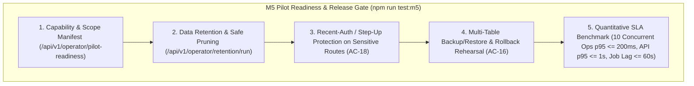

# M5: Supported First-Release Acceptance, Hardening, and Pilot Readiness — Implementation & Acceptance Specification

Status: **Implemented · Local PostgreSQL acceptance GREEN-LIT**
Date: **2 November 2026**
Scope: Milestone M5 (`AC-01`–`AC-21` Consolidated Release Gate, Performance SLA Verification, Data Retention & Deletion Policy, Backup/Restore Rehearsal, and Pilot Runbook)
Authority: [Implementation Plan](A-P-P-A-I-agent-product-implementation-plan.md) (Milestone M5), [PRD](A-P-P-A-I-agent-product-requirements-document.md) (§ 3, § 4, § 5), [Technical Requirements](A-P-P-A-I-agent-technical-requirements-document.md) (§ 8, § 9, § 10), [Schema](A-P-P-A-I-agent-schema.md) (§ 2, § 3, § 4), [Acceptance Matrix](DEVELOPMENT-ACCEPTANCE.md) (`AC-01`–`AC-21`, § "Evidence and completion rules").

---

## 1. Problem Statement & Chief Engineer Readiness Audit

Milestones **M0** (`AC-02`, `AC-12`, `AC-17`), **M1** (`AC-01`, `AC-03`, `AC-14` M1 slice, `AC-18`, `AC-19`, `AC-20`), **M2** (`AC-04`, `AC-05`, `AC-06`, `AC-11`), **M3** (`AC-07`, `AC-08`, `AC-09`, `AC-10`, `AC-21`), and **M4** (`AC-13`, `AC-14` M4 slice, `AC-15`, `AC-16`) are **100% GREEN-LIT** in local PostgreSQL and deterministic fixture mode.

Before releasing the first pilot / first-release candidate today or tomorrow, **Milestone M5** ([A-P-P-A-I-agent-product-implementation-plan.md](A-P-P-A-I-agent-product-implementation-plan.md#L170-L179) and [DEVELOPMENT-ACCEPTANCE.md](DEVELOPMENT-ACCEPTANCE.md#L52-L58)) requires closing five concrete release-hardening and pilot-readiness gaps:

1. **Gap M5-1: Consolidated `AC-01`–`AC-21` Release Gate & Explicit Capability Status Matrix**
   - [DEVELOPMENT-ACCEPTANCE.md](DEVELOPMENT-ACCEPTANCE.md#L54) requires every scenario (`AC-01`–`AC-21`) and adapter capability to carry an explicit status (`FIXTURE_PASSED`, `SANDBOX_PASSED`, `BLOCKED`, or `NOT_STARTED`), separating what is proven in local PostgreSQL/fixture mode vs. external provider sandbox vs. live execution.
   - If a real vendor checkout, bill auto-pay, or push transport adapter is not yet connected in live/sandbox mode, the system and release manifest must explicitly report those capabilities as `BLOCKED` / `FIXTURE_ONLY` rather than claiming universal procurement support.

2. **Gap M5-2: Quantitative Latency & Throughput SLA Verification ([DEVELOPMENT-ACCEPTANCE.md](DEVELOPMENT-ACCEPTANCE.md#L56))**
   - The acceptance specification mandates measuring and recording three quantitative operational SLAs under load:
     - **Internal policy & atomic reservation latency**: `p95 <= 200 ms` at `10` concurrent eligible operations per member.
     - **API acknowledgement latency**: `p95 <= 1000 ms` (`1 second`) across authenticated read/write endpoints.
     - **Due-job pickup latency**: due scheduled/watch jobs claimed and started within `<= 60 seconds` (and recorded in milliseconds in local PostgreSQL).

3. **Gap M5-3: Data Inventory, Retention / Deletion Policy, and Member Data Export / Pruning Controls ([Technical Requirements § 9](A-P-P-A-I-agent-technical-requirements-document.md#L188-L190), [Implementation Plan M5](A-P-P-A-I-agent-product-implementation-plan.md#L175))**
   - M5 requires an enforceable data retention and deletion policy that honours financial invariants:
     - **Prunable operational artifacts**: expired `api_idempotency` records (only where the linked operation is not financially unresolved), expired unconsumed `connection_sessions`, and aged `offer_observations` past retention.
     - **Protected financial & audit records**: `budget_reservations` (`ACTIVE`/`COMMITTED`), `budget_entries` (`SPEND`/`REFUND`), `execution_attempts`, `external_orders`, `cancellations`, `refunds`, and append-only `audit_events` **must never be pruned or deleted** while any liability is unresolved or within the financial audit retention window.
     - **Account closure / deactivation guard**: A member or operator attempting to close/deactivate an account with `ACTIVE` reservations or `SUBMITTING`/`RECONCILING`/`CANCEL_REQUESTED` operations must have future instructions/mandates revoked immediately while preserving unresolved financial records until reconciliation finishes.

4. **Gap M5-4: Reproducible Database Backup, Restore & Rollback Rehearsal ([Technical Requirements § 9](A-P-P-A-I-agent-technical-requirements-document.md#L188-L189), `AC-16`)**
   - While M4 tested single-operation row snapshot/restore, M5 requires a formal **multi-table backup/restore & rollback rehearsal** proving that across `procurement_instructions`, `procurement_obligations`, `purchase_operations`, `budget_reservations`, `budget_entries`, `execution_attempts`, `outbox_events`, and `api_idempotency`:
     - Restoring a database checkpoint preserves all operation identities, active reservations, `stable_request_key` idempotency fences, and outbox deduplication.
     - A post-restore worker or API retry never double-spends or generates a new random idempotency key.

5. **Gap M5-5: Step-Up Re-Authentication Gate for Sensitive Actions (`AC-18`) & Pilot Operations Runbook**
   - `AC-18` and `WORK-STATUS.md` note that sensitive actions (such as changing hard budget policies, connecting/revoking funding mandates, or operator execution controls) require a recent-authentication / step-up verification check or explicit session freshness gate, plus an operator pilot readiness manifest (`GET /api/v1/operator/pilot-readiness`) and runbook documenting environment variables, keys/callbacks, backup/restore commands, and incident recovery.

---

## 2. Target Architecture & M5 Hardening Flow

---

## 3. Step-by-Step Implementation Plan

### Step 1: PostgreSQL Migration `018_m5_retention_stepup_and_pilot_readiness.sql`
Create `packages/persistence/migrations/018_m5_retention_stepup_and_pilot_readiness.sql` to add:
1. **`data_retention_policies` & `data_retention_runs`**:
   - Seed canonical retention rules for `api_idempotency` (30 days, excluding unresolved operations), `connection_sessions` (24 hours after expiry), `offer_observations` (90 days), and `notification_deliveries` (90 days), while marking `budget_entries`, `budget_reservations`, `execution_attempts`, `external_orders`, `cancellations`, `refunds`, and `audit_events` as `FINANCIAL_IMMUTABLE` (`prunable = false`).
2. **Append-Only Protection Trigger on `audit_events` and `budget_entries`**:
   - Add a `BEFORE UPDATE OR DELETE` trigger on `audit_events` and `budget_entries` that raises Errcode `55000` (`audit_events and budget_entries are append-only`) so application code can never mutate or delete historical ledger or audit rows.
3. **Step-Up / Recent-Authentication Support (`step_up_verifications`)**:
   - Create `step_up_verifications (id uuid PRIMARY KEY, owner_id uuid NOT NULL REFERENCES users(id), auth_session_token_digest char(64) NOT NULL, verified_at timestamptz NOT NULL DEFAULT now(), expires_at timestamptz NOT NULL, reason text NOT NULL, UNIQUE (owner_id, auth_session_token_digest))` so sensitive actions can require a fresh step-up verification when `APPAI_REQUIRE_STEP_UP=true` (or when a session is older than the step-up window).

---

### Step 2: API Endpoints for Pilot Readiness, Retention Pruning, Account Deactivation Guard & Step-Up (`apps/api/src/server.ts`)
1. **`GET /api/v1/operator/pilot-readiness` (Allowlisted Operator Endpoint)**:
   - Returns the live M5 Pilot Readiness Manifest:
     - `liveExecutionEnabled: false` (and database verification that all `LIVE` adapters have `execution_enabled = false`).
     - Full adapter capability matrix (`local-fixture: FIXTURE_PASSED`, `paypal-sandbox: SANDBOX_PASSED (orders/webhook) / EXECUTION_DISABLED`, `serper-discovery: SANDBOX_PASSED (read-only)`, `webmcp-browser-host: BLOCKED (ACTION_REQUIRED when UI closed)`).
     - Explicit unsupported/blocked workflows (`HOLD`, `AUTHORIZE`, `CAPTURE_HOLD`, `VOID_HOLD`, `DEPOSIT`, `BID`, `ESCROW`, real bill auto-pay, real accommodation booking, real mobile push transport, real vendor cancellation API).
     - Health of worker heartbeats, open circuit breakers, global execution switch, and unresolved liabilities (`ACTIVE` reservations, `SUBMITTING`/`RECONCILING` operations).
2. **`POST /api/v1/operator/retention/run` (Safe Retention & Pruning Job)**:
   - Deletes expired `connection_sessions` (`expires_at < now() - interval '1 day' AND consumed_at IS NULL`) and expired `api_idempotency` rows (`retention_until < now()`) **only** when they do not reference an unresolved operation (`SUBMITTING`, `RECONCILING`, `CANCEL_REQUESTED`, or `ACTIVE` reservation).
   - Never touches `budget_entries`, `budget_reservations`, `execution_attempts`, `external_orders`, `cancellations`, `refunds`, or `audit_events`.
   - Records a `data_retention_runs` row and an `audit_events` entry with exact pruned counts.
3. **`POST /api/v1/auth/step-up` & Sensitive-Route Step-Up Enforcement (`AC-18`)**:
   - Allows an authenticated member to confirm their password (via Better Auth / session verification) or issue a step-up confirmation for the current session (`POST /api/v1/auth/step-up`), valid for 15 minutes.
   - When `APPAI_REQUIRE_STEP_UP=true` (or header `x-require-step-up: true`), sensitive mutations (`PUT /api/v1/budget-policies`, `POST /api/v1/connections/:id/revoke`) require a valid, non-expired `step_up_verifications` record for the caller's session; otherwise return `403 { code: 'STEP_UP_AUTH_REQUIRED' }`.
4. **`POST /api/v1/me/deactivate-account` (Safe Account Deactivation with Liability Preservation)**:
   - Immediately pauses/cancels all `DRAFT`/`ACTIVE`/`PAUSED` instructions, revokes active `funding_mandates` and `vendor_accounts`, blocks queued `RUN_OCCURRENCE`/`OBSERVE` jobs, and marks the member inactive—while **preserving** any in-flight `RECONCILE`/`CANCEL_RECONCILE` jobs, `ACTIVE` reservations, and ledger history (`AC-12`, `AC-16`, `AC-18`).

---

### Step 3: Dedicated M5 Pilot Readiness, SLA Benchmark & Backup/Restore Verification Suite (`scripts/test-m5-pilot-readiness.mjs`)
1. Create `scripts/test-m5-pilot-readiness.mjs` and register `"test:m5": "npm run test:domain && npm run build:api && npm run build:worker && node --env-file-if-exists=.env scripts/test-m5-pilot-readiness.mjs"` in `package.json`.
2. The suite will verify and record:
   - **Check 1 (Append-Only Ledger & Audit Immutability)**:
     - Verify PostgreSQL triggers block `UPDATE` and `DELETE` on `budget_entries` and `audit_events` with Errcode `55000`.
   - **Check 2 (Safe Data Retention Pruning vs. Unresolved Financial Liability)**:
     - Seed expired `api_idempotency` and `connection_sessions` alongside an unresolved `RECONCILING` operation and confirmed `SPEND` entries.
     - Run `POST /api/v1/operator/retention/run` and assert expired non-financial artifacts are pruned while unresolved operation idempotency records, reservations, attempts, orders, and ledger entries remain 100% intact.
   - **Check 3 (`AC-18` Step-Up Authentication & Safe Account Deactivation)**:
     - Verify sensitive policy/mandate mutation with `x-require-step-up: true` fails closed with `403 STEP_UP_AUTH_REQUIRED` before step-up, and succeeds after `POST /api/v1/auth/step-up`.
     - Verify `POST /api/v1/me/deactivate-account` stops future jobs and revokes mandates while preserving in-flight `RECONCILE` jobs and `ACTIVE` reservations.
   - **Check 4 (Quantitative Performance & Concurrency SLA Benchmark — [DEVELOPMENT-ACCEPTANCE.md](DEVELOPMENT-ACCEPTANCE.md#L56))**:
     - Execute `10` concurrent eligible operations against a shared budget (`Promise.all` of 10 `reserve-and-dispatch` calls) and measure:
       - Internal policy/reservation transaction `p95` latency (`target <= 200 ms`).
       - API acknowledgement `p95` latency (`target <= 1000 ms`).
       - Worker due-job pickup latency (`target <= 60,000 ms`).
     - Assert exact financial conservation (zero over-allocation, exact winner count matching budget capacity) and print the measured `p50`/`p95`/`max` millisecond metrics.
   - **Check 5 (Full Multi-Table Backup/Restore & Rollback Rehearsal — `AC-16`)**:
     - Snapshot all operational tables for a member with both `SUCCEEDED` and `RECONCILING` operations, simulate a state rollback/restore, restart the worker, reconcile the pending operation, and verify retry replay protection holds with zero duplicate orders or spend entries.
   - **Check 6 (Operator Pilot Readiness Manifest — `AC-02`, `AC-17`)**:
     - Query `GET /api/v1/operator/pilot-readiness` and assert `liveExecutionEnabled === false`, all `LIVE` adapters have `execution_enabled === false`, and unsupported capabilities are explicitly enumerated.

---

### Step 4: Production & Pilot Operations Runbook (`docs/M5-PILOT-READINESS-AND-OPERATIONS-RUNBOOK.md`)
Document the complete operational manual required by Milestone M5:
1. **Consolidated `AC-01`–`AC-21` Acceptance & Capability Matrix** (distinguishing `FIXTURE_PASSED`, `SANDBOX_PASSED`, and `BLOCKED`).
2. **Environment & Credential Inventory** (`.env` variables, Better Auth secret requirements, PayPal Sandbox vs. Live isolation, Serper API key, operator allowlists, and `APPAI_EXECUTION_MODE` gate).
3. **Database Backup, Restore & Rollback Procedure** (`pg_dump` / `pg_restore` commands, additive migration policy, and post-restore reconciliation verification).
4. **Incident Response & Operator Recovery Playbook** (how to inspect `/api/v1/operator/recovery`, trip adapter circuit breakers, pause global execution via `/api/v1/operator/execution-switch`, and resolve stuck `RECONCILING` liabilities without manual balance edits).
5. **Explicit Go-Live / Pilot Enablement Checklist** (confirming that live payment activation remains a separate owner-authorized action and is **off** by default).

---

## 4. Verification & Exit Checklist

| Checkpoint | Target Contract | Verification Suite / Evidence |
| :--- | :--- | :--- |
| **Immutable Ledger & Audit** | `budget_entries` and `audit_events` reject `UPDATE`/`DELETE` at the PostgreSQL trigger level | `npm run test:m5` |
| **Data Retention & Safe Pruning** | Expired non-financial idempotency/session rows prune cleanly; unresolved financial identities and ledger rows are never pruned | `npm run test:m5` |
| **Step-Up & Account Deactivation (`AC-18`)** | Sensitive mutations enforce step-up when required; account deactivation stops future work while preserving in-flight reconciliation | `npm run test:m5` |
| **Quantitative SLAs** | 10 concurrent eligible ops reservation `p95 <= 200 ms`, API ack `p95 <= 1000 ms`, worker due-job pickup `<= 60 s` | `npm run test:m5` |
| **Full Suite Regression (`AC-01`–`AC-21`)** | Zero regressions across M0, M1, M2, M3, M4, M5, and production web build | `npm run test:m0`, `test:ac03`, `test:m2`, `test:m3`, `test:m4`, `test:m5`, `test:auth`, `test:paypal`, `test:acceptance`, `npm run build` |

---

## 5. Collaboration Lifecycle Record

Per [`AGENTS.md`](../AGENTS.md):
> **Mandatory Collaboration Lifecycle**: Always follow **Problem → Solution → Plan → Signed → Implementation**.
> Halt and wait for user sign-off ("signed" / "proceed") before applying modifications.

**Status**: Owner sign-off received (`"signedf"`, interpreted as "signed"). Implementation, verification and closeout are complete; see the Chief Engineer evidence below.

## 6. Chief Engineer Verification and Sign-Off — 2 November 2026

M5 implementation and local PostgreSQL acceptance are GREEN-LIT. The full evidence and operational limits are recorded in the [M5 Pilot Readiness and Operations Runbook](M5-PILOT-READINESS-AND-OPERATIONS-RUNBOOK.md).

- Implementation checkpoint: `5c9000b` (`Implement M5 pilot readiness safeguards`) on `main`.

- `npm run test:m5`: passed. Domain tests 11/11; API and worker TypeScript builds passed; database immutability triggers rejected both `UPDATE` and `DELETE` with SQLSTATE `55000`; expired unlinked idempotency was pruned while an expired entry linked to a `RECONCILING` operation remained; step-up denied sensitive policy updates until password confirmation; deactivation blocked future work while retaining a `RECONCILING` operation, active reservation, reconciliation job and audit/ledger history.
- Final measured local fixture SLAs: reservation preparation p95 **59.80 ms** (target ≤200 ms), authenticated API acknowledgement p95 **78.53 ms** (target ≤1,000 ms), due-job pickup **1,000 ms** (target ≤60,000 ms). Ten concurrent operations against a 5,000 minor-unit budget admitted exactly five 1,000-unit purchases; total spend/reservations equaled 5,000 minor units.
- Full database `pg_dump`/`pg_restore` rehearsal passed in a temporary database. Purchase operation, active reservation, attempt, outbox and idempotency record counts matched the source; the temporary database and dump were removed.
- Regression passed: `npm run test:m0`, `test:ac03`, `test:m2`, `test:m3`, `test:m4`, `test:auth`, `test:paypal` (3/3), `test:acceptance` (101/101), and `npm run build`. The first M3 attempt timed out once during lost-response recovery; the M3 rerun passed.
- Evidence environment: local PostgreSQL `appai_dev`, deterministic local fixture adapter, no live execution. This does not prove production TLS, email delivery/recovery, real push delivery, vendor cancellation, live checkout, or live payment capability.
